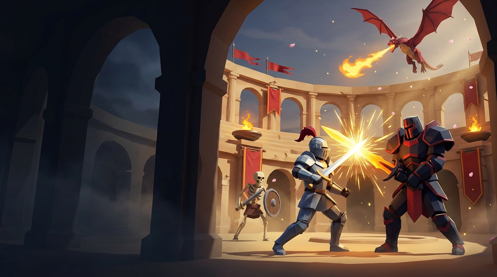

<div align="center">

# SekiroSlop

**3D Real-Time Multiplayer Sword-Combat Arena in Your Browser**

[](https://sekiroslop-eight.vercel.app/)
[](https://github.com/BhavyaJyotiSingh/sekiroslop)
[](https://www.typescriptlang.org/)
[](https://threejs.org/)
[](https://colyseus.io/)

<br />



<br />

Master timed deflects, posture breaks, shinobi slide dodges, aerial flight, and 14 signature combat arts across 4 distinct arenas on **PC, Android, and iPhone**.

[Play Now](https://sekiroslop-eight.vercel.app/) · [Architecture & Codebase Map](CODEBASE.md)

> *Note: This project is proudly vibe coded.*

</div>

---

## Features

- **Posture & Deflect Combat**: Time your guard to deflect incoming strikes, build enemy posture, stagger opponents, and punish with high-damage ripostes.
- **4 Game Modes**:
  - **Co-op Waves**: Battle escalating waves of enemies (Skeleton Warriors, Rogues, Mages, Wolves, Dread Knights, Aegis Mechs, Dragons, and more) by pulling the North Gate lever.
  - **Boss Rush**: Consecutive mythic boss trials.
  - **3v3 Team Battle**: Red vs. Blue team gladiator rounds with optional AI teammates and opponents.
  - **Mythic FFA**: Free-for-all arena combat with a sacred overdrive ring.
- **4 Selectable Arenas**:
  - **Sunlit Colosseum**: Daytime Roman amphitheater with marble columns and horse statues.
  - **Moonlit Sakura**: Nighttime Ashina shrine courtyard with glowing lanterns and drifting blossoms.
  - **Aurora Sanctuary**: Twilight crystalline sanctuary with animated aurora curtains and prism obelisks.
  - **Sunlit Sakura Garden**: Daytime spring Japanese garden surrounded by cherry blossom trees, flower-covered grounds, Torii gates, and falling petals.
- **Loadout & Progression**:
  - **6 Playable Skins**: Knight, Shadow Shinobi, Ashina Ronin, Golden Champion, Arcane Battlemage, and Cyber Valkyrie.
  - **Combat Arts & Ranged Abilities**: 14 selectable Combat Arts (e.g., Ashina Cross, Whirlwind, Dragon Flash) plus Fireball, Arcane Spell, and Stun Gun.
  - **Belt Power-ups**: Healing Flask, Posture Tonic, Warrior's Fury, Iron Will, and Swift Feet.
- **Cross-Platform Play (PC, Android & iPhone)**:
  - Desktop mouse-look with pointer lock, target lock-on, and fully rebindable keys.
  - Mobile landscape 3-finger claw touch HUD (left analog stick + right-side diamond/square action layout) with per-button drag positioning, sizing, and opacity customization.

---

## Tech Stack

- **Monorepo**: npm Workspaces (`shared`, `server`, `client`) + TypeScript
- **Frontend (`client`)**: React 19, Three.js, `@react-three/fiber`, `@react-three/drei`, `@colyseus/sdk`, Vite 8
- **Backend (`server`)**: Node.js, Colyseus 0.18, `@colyseus/schema`, Express 5, `cors`
- **Deployment**: Vercel (static client) + Railway (Dockerized Node.js / WebSocket game server)

---

## Getting Started

### Prerequisites

- **Node.js** 20+ (22 LTS recommended)
- **npm** 10+

### Installation

```bash
npm install
```

### Environment Variables (Optional for Local Dev)

Local development works out of the box without creating `.env` files (the client defaults to `ws://localhost:2567` on `localhost`).

If you want custom overrides:

- **Client** (`client/.env.local` from `client/.env.example`):
  ```env
  VITE_SERVER_URL=ws://localhost:2567
  ```
- **Server** (`server/.env` from `server/.env.example`):
  ```env
  PORT=2567
  HOST=0.0.0.0
  CORS_ORIGIN=http://localhost:5173
  ```

### Running Locally

Start both the Colyseus game server and the Vite dev server concurrently:

```bash
npm run dev
```

- Client: `http://localhost:5173`
- Server WebSocket: `ws://localhost:2567`
- Server Health Check: `http://localhost:2567/health`

Or run them individually:

```bash
npm run dev:server
npm run dev:client
```

### Building & Testing

Build all workspaces (`shared`, `server`, `client`):

```bash
npm run build
```

Run server unit & gameplay tests:

```bash
npm run test:server
```

---

## Controls

### Desktop (Default Keybindings — Rebindable in Settings)

| Action | Default Key / Mouse |
| --- | --- |
| Move | `W` `A` `S` `D` |
| Camera Look | Mouse (click canvas to lock pointer) |
| Jump / Hold to Fly | `Space` |
| Dodge Slide | `Left Shift` |
| Light / Hold Heavy Attack | `J` or `Left Click` / `Hold Left Click` |
| Deflect / Block | `L` or `Right Click` |
| Punch / Knockback | `Q` |
| Cast Selected Combat Art | `V` |
| Cast Ability (Fireball / Spell / Stun Gun) | `R` |
| Cycle Ability | `C` |
| Lock / Switch Target | `Tab` or `Middle Click` (mouse flick switches target) |
| Quick Item Belt Slots 1–3 | `4` `5` `6` |
| Pull North Gate Lever | `F` |
| In-Game Menu | `Esc` / `P` / `M` |

### Mobile Touch Controls (Landscape 3-Finger Claw)

- **Left Side**: Analog movement stick + Quick Item (`+ ITEM`) button.
- **Right Side — Lower Diamond (Thumb)**:
  - **Top**: Deflect (`DEFLECT`)
  - **Left**: Attack (`ATK / HOLD`)
  - **Right**: Dodge Slide (`DODGE`)
  - **Bottom**: Jump / Hold to Fly (`FLY/JMP`)
- **Right Side — Upper Square (Index)**:
  - **Top-Left**: Target Lock (`LOCK`)
  - **Top-Right**: Selected Combat Art (`ASHINA` / active art)
  - **Bottom-Left**: Ranged Ability (`FIRE` / active ability)
  - **Bottom-Right**: Punch (`PUNCH`)
- **Customize Layout**: Open **Menu → Settings → Customize** to drag, resize (`65%–165%`), and adjust opacity (`35%–100%`) for every individual button.

---

## Deployment

- **Client (Vercel)**: Uses root [`vercel.json`](vercel.json) to build `@sekiroslop/shared` + `@sekiroslop/client` (`client/dist`), apply security headers, and route SPA paths to `index.html`. Set `VITE_SERVER_URL` in Vercel to your Railway `wss://` URL.
- **Server (Railway)**: Uses [`railway.json`](railway.json) and [`server/Dockerfile`](server/Dockerfile) with `/health` healthchecks. Set `CORS_ORIGIN` in Railway to your Vercel frontend URL.
